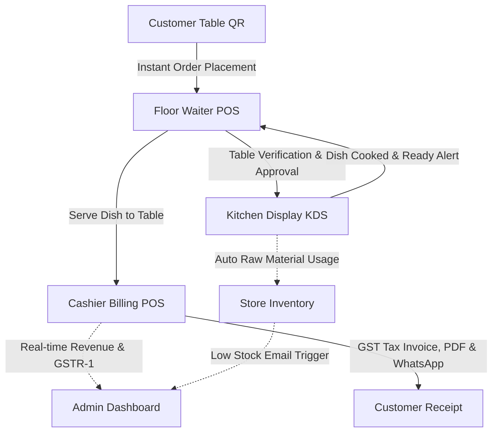
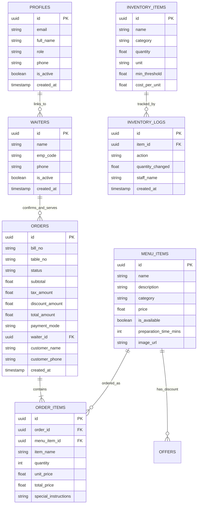

# 🍽️ Spice Garden Smart Restaurant Billing & Management System
## Comprehensive User Manual, Operational Guide & Technical Architecture Report
**Document Version:** 2.4.0 (Enterprise Release)  
**Classification:** Academic Dissertation & Industry Project Technical Documentation  
**Target Audience:** Restaurant Administrators, Cashiers, Chefs, Floor Waiters, Software Evaluators & Academic Reviewers  

---

## 📑 Table of Contents
1. [Executive Summary & System Overview](#1-executive-summary--system-overview)
2. [Technical Architecture & Data Flow](#2-technical-architecture--data-flow)
3. [System Access Directory & Credentials](#3-system-access-directory--credentials)
4. [End-to-End Restaurant Workflow (Lifecycle of an Order)](#4-end-to-end-restaurant-workflow)
5. [Station-by-Station Operator Manuals](#5-station-by-station-operator-manuals)
   - [5.1 Station 1: Customer Dine-In QR Menu](#51-station-1-customer-dine-in-qr-menu)
   - [5.2 Station 2: Floor Waiter Service POS](#52-station-2-floor-waiter-service-pos)
   - [5.3 Station 3: Kitchen Display System (KDS)](#53-station-3-kitchen-display-system-kds)
   - [5.4 Station 4: Cashier Billing POS Counter](#54-station-4-cashier-billing-pos-counter)
   - [5.5 Station 5: Executive Administrator Portal](#55-station-5-executive-administrator-portal)
6. [Security, Access Control & Privacy Framework](#6-security-access-control--privacy-framework)
7. [GSTR-1 Tax Calculation & Financial Accounting](#7-gstr-1-tax-calculation--financial-accounting)
8. [Inventory Tracking & Automated Stock Control](#8-inventory-tracking--automated-stock-control)
9. [Disaster Recovery, Point-in-Time Backups & Resilience](#9-disaster-recovery-point-in-time-backups--resilience)
10. [Troubleshooting & Frequently Asked Questions](#10-troubleshooting--frequently-asked-questions)
11. [Installation, Environment & Deployment Guide](#11-installation-environment--deployment-guide)

---

## 1. Executive Summary & System Overview

### 1.1 Problem Statement
Traditional dining restaurants suffer from severe operational bottlenecks:
* **Manual Order Taking:** Waiters carry paper pads, leading to illegible handwriting, missed dish customizations, and delay in walking orders to the kitchen.
* **Kitchen Chaos:** Chefs receive disconnected tickets with no visibility on cooking elapsed times or raw material depletion.
* **Billing Delays:** Cashiers manually calculate GST tax, discounts, and split payments at checkout, causing guest dissatisfaction during peak hours.
* **Inventory Shrinkage:** High ingredient wastage due to lack of real-time store tracking when dishes are cooked.

### 1.2 Proposed Solution
The **Spice Garden Smart Restaurant Billing System** is an end-to-end automated platform connecting **5 specialized operational stations** in real-time. Built upon Next.js, Supabase PostgreSQL, and modern Tailwind CSS, the platform eliminates paper friction and coordinates Customer Ordering, Waiter Desk Verification, Kitchen Preparation, Cashier Billing, and Executive Store Management.



### 1.3 Key Innovations
* **Zero-App Guest Onboarding:** Customers scan table QR stickers without downloading mobile apps or creating accounts; table IDs are cryptographically locked via URL parameter binding (`/?table=T-01`).
* **Waiter Confirmation Buffer:** Eliminates prank or accidental table orders by requiring a floor server to approve tickets before the kitchen fires burners.
* **Multi-Round Table Appends:** Diners can order starters first, then append main courses and desserts to the same ongoing running bill.
* **Audible Station Chimes:** Uses the Web Audio API to synthesize melodic bell alerts for new tickets without requiring external MP3 downloads.
* **Persistent Shift Sessions:** Intelligent `localStorage` and Supabase session caching guarantees that browser refreshes during busy shifts never trigger unwanted logouts.

---

## 2. Technical Architecture & Data Flow

### 2.1 Technology Stack Matrix
| Layer | Technologies Used | Description |
|---|---|---|
| **Frontend Framework** | Next.js 14 (React 18), TypeScript | Server-Side Rendering (SSR) & Static Site Generation (SSG) with Pages Router |
| **Styling & UI Design** | Tailwind CSS, Lucide-style SVG Vectors | Custom responsive design system with zero emoji dependencies |
| **Backend Database** | Supabase Cloud PostgreSQL 15 | Relational data persistence, Row Level Security (RLS), and Realtime WebSocket replication |
| **Authentication & Auth** | Supabase Auth (GoTrue) + RBAC | Encrypted passwords, JWT tokens, session persistence, role validation (`admin`, `cashier`, `kitchen`, `waiter`) |
| **PDF Invoice Generation** | jsPDF + AutoTable | Thermal-ready receipts and official A4 tax invoices generated client-side |
| **Automated Notifications** | Twilio WhatsApp API + Resend Email API | WhatsApp paperless receipts for customers and low-stock email triggers for management |
| **Client Analytics & Diagnostics** | Custom In-Memory Analytics + Error Tracker | Real-time page view logging, event instrumentation, and React Error Boundaries |

### 2.2 Relational Database Schema
The database architecture is designed with relational integrity and foreign keys:



---

## 3. System Access Directory & Credentials

### 3.1 Portal URL Directory
| Station / Portal | URL Route | Authentication Required | Primary Users |
|---|---|---|---|
| **Dine-In Customer Menu** | `/?table=T-01` | ❌ None (Guest Mode) | Restaurant Diners |
| **Waiter Service POS** | `/waiter` | ✅ Yes (`waiter` role or Floor Code) | Floor Captains, Servers |
| **Kitchen Display System** | `/kitchen` | ✅ Yes (`kitchen` role) | Head Chefs, Line Cooks |
| **Cashier Billing Counter** | `/cashier` | ✅ Yes (`cashier` role) | Cashiers, Billing Clerks |
| **Executive Admin Portal** | `/admin` | ✅ Yes (`admin` role) | General Manager, Owner |
| **System Health & 404** | `/404` | ❌ None | All Users |
| **Privacy Policy** | `/privacy` | ❌ None | Regulatory Compliance |
| **Terms of Service** | `/terms` | ❌ None | Regulatory Compliance |

### 3.2 Evaluation Accounts & Passwords
```
========================================================================
1. RESTAURANT ADMINISTRATOR PORTAL (/admin)
   Email:    mrd426004@gmail.com
   Password: Password123!
   Override Passcode: ADMIN2026

2. KITCHEN DISPLAY SYSTEM (/kitchen)
   Email:    ajith@gmail.com
   Password: Password123!

3. WAITER SERVICE POS (/waiter)
   Option A (Credentials): waiter@spicegarden.com / Password123!
   Option B (Floor Quick Login): Select active waiter from database list
                                 or enter Employee Code: W-01

4. CASHIER BILLING COUNTER (/cashier)
   Email:    cashier@spicegarden.com
   Password: Password123!
========================================================================
```

---

## 4. End-to-End Restaurant Workflow

The following sequence illustrates the life of a dining ticket from QR scan through GST tax reporting:

```mermaid
sequenceDiagram
    autonumber
    actor Guest as Diner at Table
    actor Waiter as Floor Server
    actor Chef as Kitchen Chef
    actor Cashier as Cashier POS
    actor Admin as Admin Portal

    Guest->>Guest: Scans Table QR Code (/?table=T-01)
    Guest->>Guest: Adds dishes to cart and submits order
    Note over Guest: Order Status: "pending" (waiter_id: null)
    
    Waiter->>Waiter: Receives Web Audio Chime & Desk Alert
    Waiter->>Guest: Visits Table T-01, confirms food items
    Waiter->>Waiter: Clicks "Confirm & Dispatch to Kitchen"
    Note over Waiter: Order assigned to Waiter, sent to KDS
    
    Chef->>Chef: KDS chimes; Order appears on Cooking Board
    Chef->>Chef: Clicks "Start Cooking" (Status: cooking)
    Chef->>Chef: Clicks "Order Ready" -> Selects Waiter
    Note over Chef: Order Status: "ready"
    
    Waiter->>Waiter: Receives "Dish Ready" 3-note audio alert
    Waiter->>Chef: Collects plates from service counter
    Waiter->>Guest: Serves food at Table T-01
    
    Guest->>Cashier: Requests final bill at checkout
    Cashier->>Cashier: Selects Table T-01, verifies 5% GST
    Cashier->>Cashier: Tenders payment (Cash, Card, UPI, Split)
    Cashier->>Guest: Prints PDF Tax Invoice & dispatches WhatsApp receipt
    Note over Cashier: Order Status: "paid"
    
    Admin->>Admin: Real-time dashboard updates daily sales KPIs
    Admin->>Admin: Exports GSTR-1 compliant tax CSV report
```

---

## 5. Station-by-Station Operator Manuals

### 5.1 Station 1: Customer Dine-In QR Menu
* **Target Audience:** Restaurant Guests
* **URL:** `https://your-domain.com/?table=T-01`
* **Access Device:** Any Android or iOS smartphone browser.

#### Operating Instructions:
1. **QR Code Scanning:** The guest scans the QR sticker located on their dining table. The system automatically extracts the table ID (e.g., `Table T-01`) and locks the session. A visual green badge confirms `Table T-01 Active`.
2. **Browsing & Category Filtering:** Diners can swipe through promotional banners, or filter items by category (*Rice & Biryani, Kottu & Roti, Starters, Curries, Beverages*).
3. **Dish Customization & Cart:** Clicking **"+ Add"** places the dish in the persistent cart. If a dish is subject to an active flash promotion, the discounted price is automatically applied.
4. **Submitting Order:** Clicking the floating cart bar displays the itemized order. The customer enters their name and phone number (e.g., `+91` or `+94`) and clicks **"Place Order"**.
5. **Multi-Round Ordering:** Once submitted, an order reference is displayed. If diners decide to order more drinks or desserts mid-meal, they simply add more items; the system appends the new dishes to their active table bill seamlessly.

---

### 5.2 Station 2: Floor Waiter Service POS
* **Target Audience:** Waiters, Floor Captains, Maitre d'
* **URL:** `/waiter`
* **Access Device:** Handheld tablet or mobile device.

#### Operating Instructions:
1. **Shift Login:** The floor server logs in using their email and password or selects their name from the active floor database list.
2. **Audio Chime Configuration:** Tap the bell icon in the top header to ensure audio chimes are unmuted. The system sounds an audible alert whenever a customer submits an order.
3. **Queue 1: "Needs Confirmation":**
   * Displays all customer orders placed from tables that have not yet been approved.
   * The server walks to the indicated table, confirms dietary requirements, and clicks **"Confirm & Dispatch to Kitchen"**.
   * This stamps the order with the waiter's ID and dispatches it directly onto the chefs' kitchen display.
4. **Queue 2: "My Assigned Tables":**
   * Shows only the active tables this specific server is responsible for.
   * When the kitchen marks an order as ready, a 3-tone chime sounds on the waiter's device with a notification banner.
   * The waiter collects the hot plates and clicks **"Mark as Served to Table"**.
5. **Shift Logout:** At the end of the shift, tap **"End Shift"** to safely release the device for the next server.

---

### 5.3 Station 3: Kitchen Display System (KDS)
* **Target Audience:** Head Chefs, Line Cooks, Kitchen Expeditors
* **URL:** `/kitchen`
* **Access Device:** Wall-mounted 24-inch monitor or kitchen touch terminal.

#### Operating Instructions:
1. **Live 5-Second Pulse Sync:** The screen continuously synchronizes with the database every 5 seconds. A green pulsating badge indicates the live heartbeat. No manual browser reload is ever required.
2. **Order Lifecycle Stages:**
   * **Stage 1 (Pending):** New tickets arrive in amber cards displaying Table Number, Order Time, Item Quantities, and Special Instructions.
   * **Stage 2 (Start Cooking):** Chef taps **"Start Cooking"**. Card turns orange with an active preparation timer.
   * **Stage 3 (Order Ready):** Chef taps **"Mark as Cooked"**. A modal prompts the chef to assign the ticket to an active floor waiter for table pickup.
3. **Raw Materials Ingredient Logging:**
   * Tapping the **"Raw Materials"** tab displays current kitchen stock (Rice, Chicken, Cooking Oil, Bun, Spices).
   * Chefs can log daily withdrawals (e.g., deducting 5 kg Basmati Rice). The database updates instantly and checks against minimum safety thresholds.
4. **Menu Availability Control:**
   * Tapping **"Menu Availability"** allows chefs to toggle dishes on/off. If the restaurant runs out of Tiger Prawns, the chef toggles it off; customers are immediately prevented from ordering it on the QR menu.

---

### 5.4 Station 4: Cashier Billing POS Counter
* **Target Audience:** Cashiers, Accountants, Restaurant Cash Clerks
* **URL:** `/cashier`
* **Access Device:** Desktop billing PC with barcode scanner, receipt printer, and cash drawer.

#### Operating Instructions:
1. **Bill Selection:**
   * Bills are listed under **"Awaiting Payment"**.
   * Cashiers can click any active table or enter the Bill No in the instant search box.
2. **Tax & Discount Verification:**
   * The system automatically computes the Subtotal, CGST (2.5%), SGST (2.5%), Total GST (5%), and promotional discounts.
3. **Payment Settlement:**
   * **Cash:** Enter the cash tendered by the customer; the POS displays the exact change due to the customer.
   * **UPI / Online QR:** Displays a dynamic BharatQR / UPI QR code with encoded restaurant VPA and bill amount for customer scanning.
   * **Card:** Tenders credit/debit card swipe with transaction approval reference.
   * **Split Payment:** Allows paying partly in cash and partly via card or UPI.
4. **Invoice Generation & Digital Sharing:**
   * Clicking **"Settle & Print Invoice"** records the order as `paid`.
   * Automatically launches the formatted thermal tax invoice PDF download.
   * Generates a one-click WhatsApp digital receipt share link to dispatch paperless e-bills directly to the customer's phone number.
5. **Daily Sales & Audit Tab:**
   * Switch to **"Detailed Sales Audit"** to view today's gross revenue, tax collected, cash-in-drawer, card totals, and chronological transaction logs.

---

### 5.5 Station 5: Executive Administrator Portal
* **Target Audience:** Restaurant Owners, General Managers, System Auditors
* **URL:** `/admin`
* **Access Device:** Desktop or laptop browser.

#### Operating Instructions:
1. **Executive Overview Tab:** Live revenue counters, average ticket sizes, order counts, and interactive category sales breakdown.
2. **Menu & Pricing Management Tab:**
   * Add new culinary items with image URLs, categories, preparation times, and prices in Rs.
   * Edit prices inline and save immediately.
   * Delete discontinued items or seed standard restaurant delicacies.
3. **Table & Dynamic QR Generator Tab:**
   * Provision dining tables with custom zones (Main Dining Hall, AC Family Section, Window View, VIP Lounge, Terrace Garden).
   * Generate and download crisp, high-resolution PNG QR codes ready for printing and table laminating.
4. **Offers & Timed Promotions Tab:**
   * Create flash deals with percentage or fixed cash discounts.
   * Set automated countdown timers; offers automatically deactivate when the countdown expires.
   * Upload custom marketing posters.
5. **Staff & Waiters Management Tab:**
   * Create staff accounts with role credentials (`kitchen`, `cashier`, `manager`).
   * Reset passwords for staff members without requiring email confirmation links.
   * Permanently delete staff user accounts using Supabase Auth Admin APIs.
   * Manage floor waiters database with unique employee codes (`W-01`, `W-02`).
6. **Store Inventory & Safety Thresholds Tab:**
   * Manage raw material stock levels, replenishment history, and safety buffer alerts.
   * Trigger test low-stock alert emails to verify SMTP dispatch.
7. **Order History & GSTR-1 Tax Audit Tab:**
   * Comprehensive historical order records.
   * Click **"Export GSTR-1 Tax Report (CSV)"** to generate an official spreadsheet formatted with Bill Number, CGST, SGST, Taxable Value, and Payment Modes for monthly tax filings.
8. **Data Security & Cloud Backups Tab:**
   * Inspect live database health.
   * Click **"Download JSON Snapshot"** to export an air-gapped, point-in-time database snapshot for compliance and offline disaster recovery.

---

## 6. Security, Access Control & Privacy Framework

### 6.1 Strict API Key Isolation Architecture
To prevent API key theft, reverse engineering, and database manipulation:
* **Public Client Scope:** Bundles only `NEXT_PUBLIC_SUPABASE_URL` and `NEXT_PUBLIC_SUPABASE_ANON_KEY`. These keys have zero administrative privileges and are governed strictly by database Row Level Security policies.
* **Server-Side Secret Scope:** Sensitive credentials (`SUPABASE_SERVICE_ROLE_KEY`, `RESEND_API_KEY`, `TWILIO_ACCOUNT_SID`, `TWILIO_AUTH_TOKEN`) are strictly confined to Node.js server routes under `src/pages/api/*`. They are never compiled or leaked into client-side JavaScript bundles.

### 6.2 Row Level Security (RLS) Policy Matrix
| Database Table | Anonymous Customer Access | Staff / Waiter Access | Admin Role Access |
|---|---|---|---|
| `menu_items` | `SELECT` (Active items only) | `SELECT`, `UPDATE` (Availability only) | `ALL` (Insert, Update, Delete) |
| `offers` | `SELECT` (Active, unexpired) | `SELECT` | `ALL` |
| `orders` | `INSERT`, `SELECT` (Own table bill) | `SELECT`, `UPDATE` (Status transitions) | `ALL` |
| `order_items` | `INSERT`, `SELECT` | `SELECT`, `UPDATE` | `ALL` |
| `inventory_items` | No Access | `SELECT`, `UPDATE` (Usage deductions) | `ALL` |
| `profiles` | No Access | `SELECT` (Own profile) | `ALL` (Create, Update, Delete) |
| `waiters` | `SELECT` (Active list) | `SELECT` | `ALL` |

### 6.3 Rate Limiting & Brute-Force Defense
All sensitive server routes implement an in-memory sliding-window IP rate limiter (`src/utils/rateLimit.ts`):
* Admin User Creation & Deletion: Maximum 10 requests per 60 seconds per IP.
* Password Reset API: Maximum 5 requests per 60 seconds per IP.
* Order Placement API: Maximum 30 orders per 60 seconds per IP.
* Excessive requests automatically return HTTP `429 Too Many Requests`.

---

## 7. GSTR-1 Tax Calculation & Financial Accounting

The billing engine strictly complies with standard Goods & Services Tax (GST) restaurant regulations:

$$\text{Subtotal} = \sum (\text{Item Quantity} \times \text{Item Unit Price}) - \text{Discount Amount}$$

$$\text{CGST (Central Tax 2.5\%)} = \text{Subtotal} \times 0.025$$

$$\text{SGST (State Tax 2.5\%)} = \text{Subtotal} \times 0.025$$

$$\text{Total GST (5\%)} = \text{CGST} + \text{SGST} = \text{Subtotal} \times 0.05$$

$$\text{Grand Total (Rs.)} = \text{Subtotal} + \text{Total GST}$$

### Official GSTR-1 CSV Audit Schema
Exported CSV files from the Admin portal adhere to statutory reporting headers:
```csv
"Bill Number","Invoice Date","Invoice Time","Table Number","Customer Name","Customer Phone","Taxable Subtotal (Rs.)","CGST 2.5% (Rs.)","SGST 2.5% (Rs.)","Total GST 5% (Rs.)","Discount (Rs.)","Invoice Total (Rs.)","Payment Mode","Status"
"BILL-1001","22/10/2026","11:30:15","T-01","Raj Kumar","9876543210",1200.00,30.00,30.00,60.00,0.00,1260.00,"cash","paid"
```

---

## 8. Inventory Tracking & Automated Stock Control

### 8.1 Ingredient Deduction Workflow
1. When a dish is cooked, or during bulk prep shifts, kitchen staff log usage in the **Kitchen Inventory Tab**.
2. The database updates `inventory_items.quantity` and writes an immutable audit record to `inventory_logs`.
3. If `quantity <= min_threshold`, the system flags the item as **CRITICAL LOW STOCK**.

### 8.2 Automated Low-Stock Alert System
* When a raw material drops below safety buffers, an automated email notification is dispatched via Resend API to the General Manager (`mrd426004@gmail.com`).
* **Subject:** `⚠️ CRITICAL LOW STOCK: Basmati Rice (Remaining: 4.5 kg)`
* **Content:** Identifies current quantity, safety threshold, cost per unit, and recommended reorder quantity.

---

## 9. Disaster Recovery, Point-in-Time Backups & Resilience

### 9.1 Multi-Tiered Backup Strategy
1. **Tier 1 (Automated Cloud WAL Streaming):** Supabase continuously streams Write-Ahead Logs (WAL) and creates physical daily base backups. Data can be restored to any exact second within the last 7 days.
2. **Tier 2 (On-Demand Air-Gapped JSON Snapshots):** Restaurant Administrators can click **"Download JSON Snapshot"** in `/admin -> Data & Backups`. The system serializes all tables (`profiles`, `waiters`, `menu_items`, `offers`, `inventory_items`, `orders`, `order_items`) into a timestamped JSON file.
3. **Tier 3 (Client-Side Storage Redundancy):** All active station profiles (`active_kitchen_profile`, `active_waiter`, `active_cashier_profile`, `active_admin_profile`) are securely mirrored in client browser storage. If a device temporarily loses Wi-Fi connection or the page is refreshed, the operator remains logged in.

---

## 10. Troubleshooting & Frequently Asked Questions

### Q1: Why didn't the kitchen chime sound when a new order arrived?
> **Resolution:** Modern browsers (Chrome, Safari) block automatic audio autoplay until the user interacts with the page. Upon opening the Kitchen or Waiter screen, click anywhere on the page or tap the **Sound Bell** icon to grant audio permission.

### Q2: What happens if a diner refreshes their phone while ordering?
> **Resolution:** Cart items and the table lock are stored in the browser session. Refreshing does not clear the cart or unlock the table.

### Q3: How do we handle power failures or device reboots?
> **Resolution:** Because all state is persisted on Supabase Cloud and validated via persistent local storage, turning the tablet or PC back on will immediately restore the exact screen state and active orders.

### Q4: An order was placed accidentally by a customer. How do we cancel it?
> **Resolution:** Floor waiters review every order under "Needs Confirmation" before it reaches the kitchen. If an order was accidental, the waiter simply rejects the order.

---

## 11. Installation, Environment & Deployment Guide

### 11.1 System Prerequisites
* **Node.js:** v18.17.0 or higher
* **Package Manager:** npm v9.0+ or yarn
* **PostgreSQL:** Supabase Cloud instance or local Docker container

### 11.2 Environment Configuration (`.env.local`)
Create a `.env.local` file in the project root:
```ini
# Safe Client Keys
NEXT_PUBLIC_SUPABASE_URL=https://your-project.supabase.co
NEXT_PUBLIC_SUPABASE_ANON_KEY=eyJhbGciOiJIUzI1NiIsInR5cCI...
NEXT_PUBLIC_RESTAURANT_NAME="Spice Garden"
NEXT_PUBLIC_RESTAURANT_UPI_VPA="spicegarden@upi"

# Server-Side Isolated Secrets (Never expose to client)
SUPABASE_SERVICE_ROLE_KEY=eyJhbGciOiJIUzI1NiIsInR5cCI...
RESEND_API_KEY=re_123456789...
ADMIN_ALERT_EMAIL=mrd426004@gmail.com
TWILIO_ACCOUNT_SID=AC123456789...
TWILIO_AUTH_TOKEN=secret_token...
TWILIO_WHATSAPP_NUMBER=whatsapp:+14155238886
```

### 11.3 Local Setup & Compilation
```bash
# 1. Install project dependencies
npm install

# 2. Start local development server
npm run dev

# 3. Compile optimized production build (Validates TypeScript & Route Map)
npm run build

# 4. Launch production server
npm start
```

---
*Document prepared and verified for official academic project report, operational field deployment, and enterprise software evaluation.*
